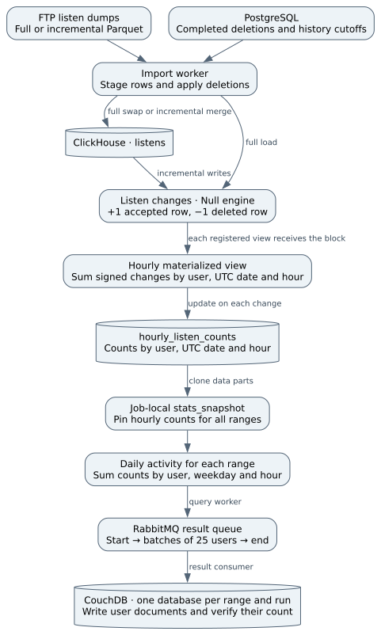

Daily and listening activity
============================

Daily activity
--------------

User daily activity answers “How many listens did this user submit on Mondays
between 09:00 and 10:00 UTC?” for each weekday and hour in a selected period.

Running a refresh
~~~~~~~~~~~~~~~~~

.. code-block:: console

   $ python manage.py clickhouse daily_activity --range week --range month

Omitting ``--range`` refreshes all nine ranges. The hourly materialized view
sums listen changes by user, UTC date and hour in ``hourly_listen_counts``.
The job calls ``aggregate_snapshot(HOURLY_COUNTS)`` once and reads that
snapshot for every requested range.

Range boundaries and delivery
~~~~~~~~~~~~~~~~~~~~~~~~~~~~~

The UTC time at the start of the job anchors every range, even when imports lag.
For example, on February 1, ``this_month`` selects February and ``month``
selects January. The worker sums the hourly counts by user, weekday and hour and emits only populated cells.
Completed periods end at the start of the next period, exclusively. A listen at
February 1 00:00:00 UTC belongs to February. All-time and ongoing ranges include
buckets through the current UTC date.

For each range the worker publishes a start message, batches of up to 25 users,
and an end message containing the expected user count. The consumer creates
``clickhouse_daily_activity_<range>_<generation>`` and writes each user's
document under their user ID. Each document includes the range timestamps and
a list of ``day``, ``hour`` and ``listen_count`` records.

On a transient CouchDB request failure the consumer immediately requeues the
message. Other prefetched results may be processed before redelivery. At the end of the run,
the consumer checks the stored document count before removing older unlocked
generations for that range. A count mismatch preserves the previous generation.
A successful empty range retires old results in the same way.

Listening activity
------------------

Run ``python manage.py clickhouse listening_activity --range month`` to refresh
the per-user listening histogram. As with daily activity, repeat ``--range``
to select several ranges or omit it to refresh all nine from one hourly snapshot.

Completed ranges cover the last two calendar periods. Ongoing ranges compare
the period containing yesterday with its predecessor, through yesterday UTC.
Week, month and quarter reports have daily buckets. Half-year and year reports
have monthly buckets. All-time reports have yearly buckets from 2002 and count
listens through the current UTC date.

The worker writes to ``clickhouse_listening_activity_<range>_<generation>``
using the same delivery and replacement protocol as daily activity. Each active
user gets a chronological list of buckets with a ``time_range`` label, inclusive
``from_ts`` and ``to_ts`` in Unix seconds, and a ``listen_count`` of zero for
buckets without listens.
